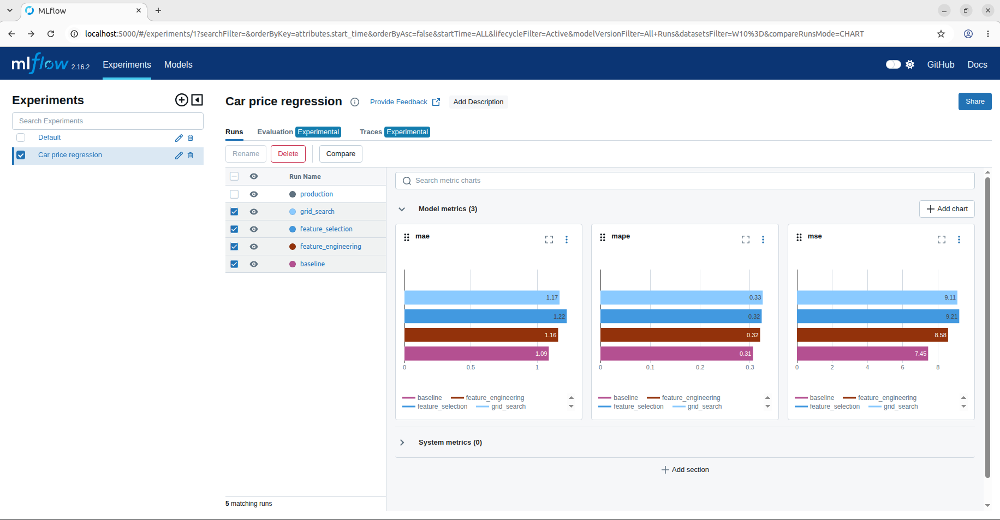
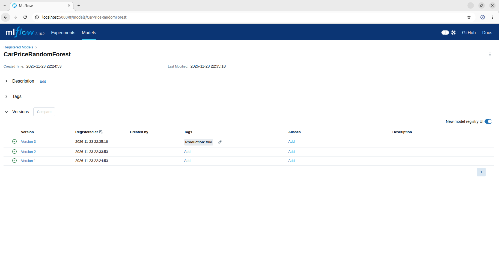

# Прогнозирование цены подержанных автомобилей

Проект по предмету «Интеллектуальные информационные системы». В первой лабораторной работе выполняется разведочный анализ данных (EDA), а во второй на очищенных данных обучается модель для предсказания цены продажи автомобиля `Selling_Price`.

## Используемые данные

Датасет **Car Price Prediction (Used Cars)**. Исходная таблица содержит 301 строку и 9 столбцов. Целевая переменная - `Selling_Price`. Это задача регрессии, так как предсказывается числовое значение цены.

Файлы `data/car data.csv` и `data/clean_dataset.pkl` хранятся только локально и не загружаются на GitHub.

## Запуск проекта в Ubuntu

1. Склонировать проект (если его ещё нет на компьютере):

   ```bash
   git clone https://github.com/yuechkaa/my_proj1.git
   cd my_proj1
   ```

   Если папка уже создана, просто открыть её в VS Code. Все дальнейшие команды выполняются из корня проекта.

2. Создать и активировать виртуальное окружение:

   ```bash
   python3 -m venv .venv_my_proj1
   source .venv_my_proj1/bin/activate
   ```

3. Установить библиотеки:

   ```bash
   python -m pip install -r requirements.txt
   python -m pip install ipykernel
   ```

4. Поместить исходный CSV в папку `data/` с именем **`car data.csv`**. Данные не входят в Git-репозиторий.

5. Открыть `eda/eda.ipynb` в VS Code, выбрать Python-интерпретатор из `.venv_my_proj1` и выполнить **Run All**. В результате появятся графики в папке `eda/`, а очищенный файл - в `data/clean_dataset.pkl`.

Для следующей лабораторной сохранить `data/clean_dataset.pkl` отдельно, например на флешку или в облако.

## Структура проекта

```text
my_proj1/
├── data/                     # Исходный CSV и очищенный pickle (не в Git)
├── eda/
│   ├── eda.ipynb            # Исследование данных и очистка
│   ├── graph1_selling_price.png
│   ├── graph2_present_vs_selling.png
│   ├── graph3_year.png
│   ├── graph4_fuel.png
│   ├── graph5_transmission.png
│   └── graph6_interactive.html
├── .gitignore
├── README.md
└── requirements.txt
```

## Очистка данных (ЛР1)

Проверены типы всех столбцов и наличие пропусков. Пропущенных значений не обнаружено. Найдены и удалены **2 полных дубликата**. После очистки осталось **299 строк**. Числовые и категориальные признаки выделены отдельно. Новые признаки в ЛР1 не создавались.

Очищенная таблица сохранена в `data/clean_dataset.pkl` для использования в ЛР2.

## Результаты EDA

**1. Цена продажи.** Распределение `Selling_Price` имеет правостороннюю асимметрию: большая часть автомобилей стоит относительно недорого, но присутствуют значительно более дорогие машины.

**2. Текущая стоимость.** На графике `Present_Price` против `Selling_Price` заметна положительная связь: автомобили с более высокой текущей стоимостью обычно продаются дороже.

**3. Год выпуска.** В среднем более новые автомобили продаются дороже, однако по отдельным годам есть отклонения.

**4. Тип топлива.** В данном датасете дизельные автомобили в среднем дороже бензиновых и автомобилей на CNG. Это наблюдение не означает, что именно тип топлива вызывает разницу в цене.

**5. Коробка передач.** Автомобили с автоматической коробкой в среднем дороже автомобилей с механической коробкой.

**6. Пробег.** По интерактивному графику видно, что автомобили с похожим пробегом могут сильно различаться по цене, поэтому для прогноза важно учитывать несколько признаков одновременно.

## Результат ЛР1

Получен очищенный датасет из 299 автомобилей. Наиболее перспективными для дальнейшего моделирования выглядят `Present_Price`, `Year`, `Driven_kms`, `Fuel_Type` и `Transmission`. Следующим этапом является обучение моделей и сравнение качества в ЛР2.

## ЛР2. Проведение экспериментов по настройке модели

### Запуск MLflow

В корневой директории проекта выполнить:

```bash
source .venv_my_proj1/bin/activate
cd mlflow
bash start_mlflow.sh
```

Интерфейс MLflow доступен по адресу http://localhost:5000.

Исследования проводятся в блокноте `research/research.ipynb`.

### Результаты исследования

Данные были разделены на обучающую (75%) и тестовую (25%) выборки. Для числовых признаков использовался StandardScaler, для категориальных - OrdinalEncoder. В качестве модели использовался RandomForestRegressor.

Были проведены четыре эксперимента:

| Эксперимент | MAE | MAPE | MSE |
|---|---:|---:|---:|
| Baseline | 1.0879 | 0.3060 | 7.4462 |
| Генерация признаков | 1.1582 | 0.3203 | 8.5783 |
| Отбор признаков | 1.2235 | 0.3235 | 9.2122 |
| Подбор гиперпараметров | 1.1693 | 0.3256 | 9.1085 |

Для генерации признаков использовались PolynomialFeatures и KBinsDiscretizer. При экспертном отборе было оставлено 8 из 19 признаков.

Для настройки гиперпараметров использовался GridSearchCV. Было проверено 12 комбинаций параметров с кросс-валидацией на 3 блоках.

Лучший результат на тестовой выборке показала baseline-модель. Генерация и отбор признаков, а также подбор гиперпараметров не привели к уменьшению ошибки на тестовой выборке.

### Итоговая модель

Параметры выбранной модели:

- n_estimators = 100
- max_depth = None
- max_features = 1.0
- random_state = 42

Используемые признаки:

- Year
- Present_Price
- Driven_kms
- Owner
- Car_Name
- Fuel_Type
- Selling_type
- Transmission

Итоговая модель была обучена на всей очищенной выборке из 299 автомобилей и зарегистрирована в MLflow.

- Название модели: CarPriceRandomForest
- Версия: 3
- Тег: Production
- Run ID: `363668ff43144c9c83afb9c3cb979316`

### Скриншоты MLflow





Описание итоговой модели сохранено в файле `research/MLmodel`.
